<div align="center">

<picture>
  <source media="(prefers-color-scheme: dark)" srcset=".github/assets/banner-dark.svg">
  
</picture>

**The `whatsapp-web.js` experience, now in persistent, pure PHP.**<br>
Terminal QR · persistent sessions · real-time events · media · groups · channels · calls. PAM keeps the process alive, [PAM Browser](https://github.com/push-in/pam-browser) speaks the Chrome DevTools Protocol, and this library provides the typed API: no Node.js, npm, Puppeteer or Playwright in production.

[](https://packagist.org/packages/pushinbr/pam-whatsapp-web)
[](https://github.com/push-in/pam-whatsapp-web/releases/latest)

[](LICENSE)

[Install](#install) · [Quick example](#quick-example) · [Features](#whats-included) · [Compatibility](#compatibility) · [Safety](#responsible-use) · [Cookbook](docs/supported-features.md)

</div>

<a id="install"></a>
## <picture></picture> Install

Create a PAM project and add the library:

```sh
pam init my-whatsapp --template raw
cd my-whatsapp
pam composer require pushinbr/pam-whatsapp-web
```

Chrome or Chromium must be installed on the host. No JavaScript runtime is required. New to PAM? Install it from [push-in/pam](https://github.com/push-in/pam#install) and run `pam doctor` first.

<a id="quick-example"></a>
## <picture></picture> Quick example

Create `listen.php`:

```php
<?php

declare(strict_types=1);

require __DIR__.'/vendor/autoload.php';

use Pam\WhatsApp\Auth\LocalAuth;
use Pam\WhatsApp\Auth\LocalAuthOptions;
use Pam\WhatsApp\Client;
use Pam\WhatsApp\ClientOptions;
use Pam\WhatsApp\Event\MessageReceived;
use Pam\WhatsApp\Event\QrCodeReceived;
use Pam\WhatsApp\Event\Ready;
use Pam\WhatsApp\TerminalQrCode;

$client = new Client(new ClientOptions(
    authStrategy: new LocalAuth(new LocalAuthOptions(
        clientId: 'main',
        dataPath: __DIR__.'/.sessions',
    )),
));

$client->onQrCode(static function (QrCodeReceived $event): void {
    echo "\n\nOpen WhatsApp > Linked devices > Link a device\n\n";
    echo TerminalQrCode::render($event->code), "\n";
});

$client->onReady(static function (Ready $event): void {
    echo "\n\n✓ WhatsApp connected. Waiting for messages...\n";
});

$client->onMessage(static function (MessageReceived $event): void {
    $message = $event->message;
    $body = $message->body !== '' ? $message->body : '['.$message->type->name.']';

    printf("[%s] %s: %s\n", date('H:i:s', $message->timestamp), $message->from, $body);
});

$client->initialize();
$client->run();
```

Run it with `pam listen.php`. On the first run, a scannable QR code appears in the terminal. After scanning, the client connects automatically and starts printing inbound messages. Authentication is stored in `.sessions/`; subsequent runs restore the session without another QR code. Never publish this directory or share its contents.

> The complete runnable program is available at [`examples/listen.php`](examples/listen.php).

<a id="platform-support"></a>
## <picture></picture> Platform support

| Platform | Support | Notes |
| --- | --- | --- |
| PAM runtime host | Chrome or Chromium installed | Driven through [PAM Browser](https://github.com/push-in/pam-browser) (`pushinbr/pam-browser` `^1.0`) |
| PHP | 8.5+ | `ext-mbstring`; from `composer.json` |
| whatsapp-web.js | 1.34.7 | Reference commit `942d236`, from `api-matrix.json` |

<a id="whats-included"></a>
## <picture></picture> What's included

| Area | Features |
|---|---|
| Session | QR, pairing code, `LocalAuth`, `RemoteAuth`, reconnection, and session conflict handling |
| Messages | text, replies, editing, deletion, forwarding, reactions, mentions, and read receipts |
| Media | images, audio, video, documents, stickers, thumbnails, and streaming downloads |
| Conversations | contacts, private chats, groups, participants, invites, and membership requests |
| Content | locations, polls, contacts, contact lists, scheduled events, and legacy buttons/lists |
| WhatsApp | presence, connection state, calls, channels, labels, business profiles, products, and orders |
| API | typed objects, integer-backed enums, immutable events, PHPStan level 9, and an automated parity matrix |

<a id="common-tasks"></a>
## <picture></picture> Common tasks

#### Reply to a message

```php
$client->onMessage(static function (MessageReceived $event): void {
    if ($event->message->body === '!ping') {
        $event->message->reply('pong 🟢');
    }
});
```

#### Send messages and manage chats

```php
$client->sendMessage('15551234567@c.us', 'Hello directly from PHP!');
$client->sendPresenceAvailable();
$client->archiveChat($chatId);
$client->muteChat($chatId, new DateTimeImmutable('+1 hour'));
$contact = $client->getNumberId('5511999999999');
```

For unsaved contacts, pass any human-readable international number. The client
normalizes it, verifies that it is registered, resolves its current WhatsApp ID,
and sends the message:

```php
use Pam\WhatsApp\RetryOptions;

$message = $client->sendMessageToNumber(
    '+55 (11) 99999-9999',
    "Hello!\nThis message has two lines.",
    retry: new RetryOptions(maxAttempts: 3),
);
```

Retries are opt-in because retrying an ambiguous send failure can produce a
duplicate. The default is one attempt.

#### Send media with one call

```php
$client->sendImageToNumber('+55 11 99999-9999', __DIR__.'/photo.jpg', 'Photo caption');
$client->sendAudioToNumber('+55 11 99999-9999', __DIR__.'/voice.ogg');
$client->sendDocumentToNumber('+55 11 99999-9999', __DIR__.'/invoice.pdf');
$client->sendStickerToNumber('+55 11 99999-9999', __DIR__.'/sticker.webp', 'Pack name', 'Author');
```

#### Observe delivery

```php
$client->onMessageSent(fn ($event) => printf("Sent: %s\n", $event->message->id));
$client->onMessageDelivered(fn ($event) => printf("Delivered: %s\n", $event->message->id));
$client->onMessageRead(fn ($event) => printf("Read: %s\n", $event->message->id));
$client->onMessageFailed(fn ($event) => printf("Failed: %s\n", $event->message->id));
```

These convenience events are derived from the typed upstream acknowledgement
event. `on(EventType::MessageAcknowledged, ...)` remains available unchanged.

#### Reconnection, diagnostics, and logs

```php
use Pam\WhatsApp\ClientOptions;
use Pam\WhatsApp\LogLevel;

$client = new Client(new ClientOptions(
    autoReconnect: true,
    reconnectMaxAttempts: 5,
    reconnectDelayMs: 1_000,
    logger: static function (LogLevel $level, string $message, array $context): void {
        fwrite(STDERR, sprintf("[%s] %s %s\n", $level->name, $message, json_encode($context)));
    },
));

$diagnostics = $client->diagnoseSession();
if (!$diagnostics->healthy()) {
    var_dump($diagnostics);
}
```

Automatic reconnect is disabled by default to preserve existing production
behavior. Logout and QR retry exhaustion are never reconnected automatically.
`Client::reconnect()` is available after a closed or failed session.

#### Download large media without exhausting memory

```php
use Pam\WhatsApp\MediaStreamOptions;

$media = $message->downloadMediaStream(new MediaStreamOptions(
    chunkSize: 1024 * 1024,
));

if ($media !== null) {
    foreach ($media->stream as $chunk) {
        // Persist or forward each binary chunk.
    }
}
```

<a id="supported-features"></a>
## <picture></picture> Upstream supported-feature status

Every feature currently marked ✅ in the upstream `whatsapp-web.js` README is
represented by the typed PHP API: Multi Device, send/receive messages, all
listed media formats, stickers, contact cards, locations, replies, group
administration, mentions, chat mute, contact block, contact/profile operations,
status, reactions, polls, and channels.

Buttons and list messages are deprecated and marked ❌ upstream. Their PHP types
remain for source compatibility, but successful delivery is not guaranteed.
Communities are marked 🔜 upstream and are not advertised as a completed
feature here.

A working PHP example for every row of the upstream Supported features table is in the **[supported-feature cookbook](docs/supported-features.md)**; the machine-readable mapping is [`supported-features.json`](supported-features.json).

<a id="compatibility"></a>
## <picture></picture> Compatibility

The current release tracks `whatsapp-web.js` `1.34.7` at reference commit
`942d236a11ad68807308b058303ba5256915979c`. Coverage is auditable in
[`api-matrix.json`](api-matrix.json): **81 symbols + 670 members, 751/751 strict
contracts**.

```bash
pam composer parity:gate
pam composer test
pam composer analyse
```

Live certification is split between an unauthenticated QR smoke test and an
authenticated suite with explicit mutation guards. See
[`CERTIFICATION.md`](CERTIFICATION.md).

<a id="architecture"></a>
## <picture></picture> Architecture

```text
your PHP code
      │
      ▼
PAM WhatsApp Web ── typed events and objects
      │
      ▼
PAM Browser ─────── Chrome DevTools Protocol
      │
      ▼
Chrome / Chromium ─ WhatsApp Web
```

<a id="responsible-use"></a>
## <picture></picture> Responsible use

This is an unofficial, community-maintained library. WhatsApp may change its
internal modules without notice and may restrict or block accounts that violate
its terms. Avoid spam and abusive automation. For officially supported
integrations and critical workloads, use Meta's WhatsApp Business Platform.

<a id="docs"></a>
## <picture></picture> Docs

- [Supported-feature cookbook](docs/supported-features.md)
- [Certification](CERTIFICATION.md)
- [Release process](RELEASE.md)
- [Changelog](CHANGELOG.md)
- [Report an issue](https://github.com/push-in/pam-whatsapp-web/issues)

<a id="pam-ecosystem"></a>
## <picture></picture> Part of the PAM ecosystem

<p align="center"><picture>
  <source media="(prefers-color-scheme: dark)" srcset=".github/assets/pam-wordmark-dark.svg">
  
</picture></p>

PAM runs PHP natively on servers, desktops and phones. This repository is one piece of it.

| [**PAM**](https://github.com/push-in/pam) | [**PAM Desktop**](https://github.com/push-in/pam-desktop) | [**PAM Native**](https://github.com/push-in/pam-native) | [**Ecosystem**](https://github.com/push-in/pam#ecosystem) |
| --- | --- | --- | --- |
| the runtime and CLI | native desktop apps in PHP | native Android and iOS apps in PHP | every official package and plugin |

<sub>Docs: [push-in.github.io/pam-docs](https://push-in.github.io/pam-docs/introduction/) · [Issues](https://github.com/push-in/pam-whatsapp-web/issues)</sub>

<p align="center"><sub>Open source under the <a href="LICENSE">Apache License 2.0</a>: use, modify and distribute it, including commercially · Made in Brazil by Pushin</sub></p>
